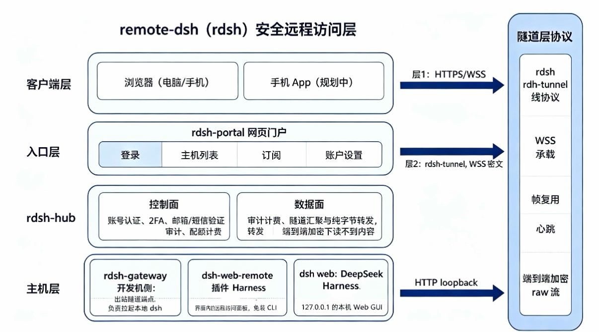

# remote-dsh

**English** | [中文](README.zh.md)

**remote-dsh turns your DeepSeek Harness (DSH) into an AI agent you can use from any browser — no public IP, no client install.**


## Why remote-dsh

- **Browser-first**: no public IP, no client install — open a browser and drive your agent from any device (PC / tablet / phone) and any OS (Mac, Windows, Linux, iOS, Android, HarmonyOS);
- **Always on**: sessions stay live and follow you seamlessly across devices — no interrupted workflows;
- **Two access paths**: the DSH plugin (`dsh-web-remote`) for one-click setup, or the CLI (`remote-dsh`) for full control;
- **End-to-end encrypted**: TLS for transport plus end-to-end encryption (E2EE) — the hub relays only ciphertext and can never read your actions or data;
- **Account protection**: password login + two-factor authentication (2FA), automatic lockout after repeated failures, protection against credential stuffing;
- **Host access code**: optionally set a second, independent password on the host — even the hub admin cannot get in;
- **Access isolation**: your hosts are visible only to you and the people you share them with;
- **Open & auditable**: MIT-licensed, frozen protocol — self-host it, embed it, and audit the code; security you can verify.

## Use cases

### ① Get started fast (rdsh Hub cloud relay)
- **For**: most users who want the fastest path — no self-hosted hub, no public IP;
- **Needs**: an rdsh.cn account:
  - **Option 1**: sign up directly on the [rdsh.cn](https://rdsh.cn) website;
  - **Option 2**: download the **WhaleLink App** and sign up in the app (recommended) — get it from [rdsh.cn](https://rdsh.cn) or your app store; besides access-from-anywhere, it also has strong two-way voice.
- **Result**: access from anywhere (laptop / phone / in-WeChat browser) by signing in;
- **Note**: the plugin pins DSH's workspace directory picker to the **in-app browser**, so choosing a workspace works from a remote browser (a host OS dialog would open on the host's own screen, out of your reach).

**Route 1 · DSH desktop app plugin (no CLI)**

1. Open the DSH desktop app → "Plugins" in the top-left → install a third-party plugin;
2. Enter the plugin name `dsh-web-remote`, then open the plugin panel;
3. Bind this machine: **recommended — pull out the WhaleLink App and scan the QR code** (faster); or paste the hub URL + join token in the panel.

**Route 2 · CLI (for servers / headless embedded hosts)**

```bash
npm install -g remote-dsh
rdsh join                       # bind this machine: omit the hub URL to print a QR code, then scan it with the WhaleLink App
rdsh service install            # recommended: install as a system service (auto-restart + start on boot)
```

> Foreground is for debugging only: `rdsh serve`.

### ② Direct connection (no hub)
- **LAN**: on the same network, `rdsh serve` then connect by IP with the access code;
- **Cloud server**: a host with a public IP/domain, `rdsh serve` + TLS password auth, connect by IP/domain;
- **For**: technical users who want full control and no third-party hub.

```bash
npm install -g remote-dsh
rdsh setup lan                 # or setup cloud (needs --tls-cert/--tls-key)
rdsh serve                     # run it (spawns dsh web)
# open http://<ip>:<port> in a browser on the same network, enter the access code
```

### ③ Self-hosted (self-hosted hub · full control)
- **Self-hosted hub**: run `rdsh-hub serve` on your own machine or cloud host, with multi-user / audit / sharing;
- **For**: teams / enterprises that want unified accounts, audit, and data ownership.

```bash
npm install -g rdsh-hub-cli
rdsh-hub serve                  # self-host the hub (built-in TLS or behind a reverse proxy)
# members join via ① (plugin) or `rdsh join <your-hub>`
```

## Architecture



```
        Client (browser)
                    │
                    │  HTTPS/WSS — layer 1: hub public API
                    ▼
                rdsh-hub
                    │
                    │  WSS tunnel — layer 2: rdsh-tunnel
                    ▼
             rdsh-gateway
                    │
                    │  HTTP (loopback)
                    ▼
          dsh web (127.0.0.1)
```

Two protocol layers: **layer 1** (hub public API, JSON over HTTPS + WSS events)
is the only contract clients implement; **layer 2** (`rdsh-tunnel`) runs between
hub and gateway only — clients never implement it.

## Components

| Component | Name | Role |
|---|---|---|
| CLI (host) | `rdsh` (`remote-dsh`) | `rdsh setup/join/serve` — configure & run the gateway/host |
| CLI (hub) | `rdsh-hub` (`rdsh-hub-cli`) | run & manage the hub server (`serve` / `user` / `audit` / `host` / `service`) |
| Server | rdsh-hub | control plane (auth, host registry, routing) + data plane (tunnel relay) |
| Host agent | rdsh-gateway | LAN auth gateway / outbound tunnel endpoint; spawns `dsh web` |
| Tunnel protocol | rdsh-tunnel | wire protocol: framing, multiplexing, heartbeat |
| Portal | rdsh-portal | web login + host list (Vite + React) |
| DSH plugin | dsh-web-remote | remote-access panel inside the DSH UI (no CLI) |

> **Scale-out relay nodes** are part of the commercial edition (`rdsh-cloud`,
> proprietary). A single self-hosted hub already includes a built-in relay; no
> extra component is required for normal self-hosting.

## Capabilities & status

**Current status**: M1–M5 implemented and verified; **end-to-end encryption
(E2EE) is complete** (community + SaaS). See [features.md](doc/overview/features.md)
for the full feature list; [roadmap](doc/overview/roadmap.md) for milestones.

**Core capabilities**:
- **Three access modes**: LAN direct / cloud-server direct (TLS + password) / public hub relay (outbound tunnel)
- **End-to-end encryption**: the hub relays your DSH traffic but cannot read the content (prompts / code / files / API keys stay encrypted) — Noise NK handshake (X25519 + AES-256-GCM), fresh session keys per connection, browser TOFU fingerprint trust, pin stored locally only
- **Multi-tenant & security**: email verification + 2FA, host sharing (owner/member), audit log, login rate-limiting (lockout + throttling), IP allow-list, optional host access code (a second lock on the host — even a hub admin cannot get in)
- **Two access paths**: the `dsh-web-remote` plugin (no CLI) or the `remote-dsh` CLI; the hub runs via `rdsh-hub` with built-in TLS or behind a reverse proxy

**Planned**: SaaS managed hub.

## Blog

Scenario guides, from simple to complex — full index: [English](doc/blog/README.md) · [中文](doc/blog/README.zh.md)

**Use it now (recommended route)**:
- [Create an rdsh.cn account: 3 minutes to your first remote access](doc/blog/en/01-03-rdsh-account.md)
- [Get an access token: bind your computer to your account](doc/blog/en/01-04-join-token.md)
- [Install a plugin: reach your DSH securely from anywhere](doc/blog/en/01-05-plugin-mode.md) — the easiest route when the DSH web UI already runs on the computer

**Optional: other access routes & going further**:
- [One command: reach your DSH securely from anywhere](doc/blog/en/01-06-cli-mode.md) — the CLI equivalent, same capability
- [LAN direct access with an access code: control your DSH on the same network](doc/blog/en/01-01-lan-access.md)
- [Account security: protections the platform gives you, plus locks you can add](doc/blog/en/01-08-account-security.md)
- [Put your DSH on a cloud server: HTTPS + password sign-in (own cert)](doc/blog/en/02-01-cloud-single-tls.md)
- [Run your own hub relay: ECS deploy with built-in TLS (fastest)](doc/blog/en/03-01-hub-public.md)

## Version compatibility

remote-dsh follows the latest DeepSeek Harness (dsh). **A single rdsh release is
smoke-tested against multiple dsh versions**; if a mismatch is detected at
runtime, the CLI prints an upgrade command — you never need to consult a
version matrix. Smoke-tested dsh versions:

- `0.1.1-rc.2` ✅
- `0.1.2-rc.1` ✅
- `0.1.5-rc.2` ✅
- `0.1.7-rc.2` ✅
- `0.2.1-rc.2` ✅

(per-release history in [CHANGELOG](CHANGELOG.md)).

## Development

- Node.js ≥ 22 (see `.nvmrc`), pnpm ≥ 9
- TypeScript monorepo (`packages/*`); Go scale-out components live in the private `rdsh-cloud` repo
- See [CONTRIBUTING.md](CONTRIBUTING.md) and the public docs under `doc/`; implementation docs are maintained in the private repository

## License

MIT — see [LICENSE](LICENSE). Brand assets (logo, name) are excluded — see [NOTICE](NOTICE).
